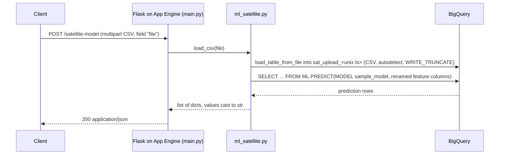

# Analytics-Applications-Engineering

Northwestern University, M.S. in Data Science (Data Engineering specialization) · MSDS 434: Analytics Application Engineering

## Overview

The MSDS 434 project: take a model that lives in a data warehouse and put it behind a deployable web service. A Flask app on Google App Engine accepts a CSV of satellite feature records, loads it into BigQuery, scores it with a BigQuery ML model through `ML.PREDICT`, and returns predictions as JSON. The point of the course was the application engineering around the model (service layout, environments, CI/CD, testing), not the model itself.

## Request flow

Other routes: `GET /` is a plain-text health check, and `GET /get-model` returns up to 1,000 rows of the `sat_analytics` table as JSON.

## Highlights / Results

| Work | Method | Result | Source |
|------|--------|--------|--------|
| In-warehouse inference service | Flask + BigQuery `ML.PREDICT` over an uploaded CSV | Three routes: health, table export, CSV upload to predictions | `main.py`, `ml_satellite.py` |
| Multi-environment deployment | App Engine Flex services `default`, `dev`, `production` from one codebase | One `gcloud app deploy` call deploys all three | `app.yaml`, `servicedev.yaml`, `serviceprod.yaml`, `deploy.sh` |
| CI/CD | CircleCI on the `google/cloud-sdk` image: install, `make test`, `make lint`, then `gcloud app deploy` | Deploy runs only after tests and lint pass | `.circleci/config.yml` |
| Offline test suite | pytest with the BigQuery client mocked; Flask test client for routes | 12 tests, no GCP credentials needed | `tests/` |
| Model input schema | 36 feature columns plus a label; 1,000 sample records across 6 classes (1, 2, 3, 4, 5, 7) | Used to shape upload CSVs | `model.json` |

No model metrics are reported here: the model (`sample_model`) was trained in BigQuery outside this repository, and no evaluation output was saved in the repo.

## Engineering decisions and tradeoffs

- **Inference in the warehouse, not in the app.** The app never loads model weights; it ships rows to BigQuery and calls `ML.PREDICT`. That keeps the App Engine instance small (1 CPU, 0.5 GB in the YAML configs) and lets the model be retrained in SQL without redeploying. The cost is latency (a load job plus a query per request) and a hard dependency on BigQuery for every prediction.
- **Load job instead of streaming inserts.** Uploads go through `load_table_from_file` with schema autodetect, so any CSV with the expected headers works without a hand-written schema. Autodetect is also the weak point: a malformed file fails inside BigQuery and surfaces as a 500, not a validation error.
- **Column renaming at query time.** Upload files use names like `Aattr` and `F30attr`; the `ML.PREDICT` subquery aliases them to the model's training names (`A` through `F30`, `class AS label`). That decouples the upload format from the training schema, at the price of a 36-line alias list that has to match the model exactly.
- **Separate dev and production services.** `servicedev.yaml` and `serviceprod.yaml` define distinct App Engine services with the same runtime, so a build can be checked on the `dev` URL before traffic hits `production`. `deploy.sh` deploys all three at once; the CircleCI job deploys only `app.yaml` (the `default` service).
- **Thin route layer.** `main.py` only parses the request and serializes the response; all BigQuery logic is in `ml_satellite.py`. That split is what makes the routes testable with a stubbed module and the BigQuery logic testable with a mocked client.

## Limitations and what I would do differently today

- **Training is outside the repo.** `sample_model` and the `sat_analytics` table were created directly in BigQuery. Today I would keep the `CREATE MODEL` statement and its `ML.EVALUATE` output in version control so the model is reproducible.
- **Ephemeral tables are never cleaned up.** Each upload creates `sat_upload_<unix seconds>` and leaves it in the dataset. Two uploads in the same second hit the same table and, with `WRITE_TRUNCATE`, the second overwrites the first. I would use a UUID table name with a table expiration, or skip the load and pass rows as query parameters for small payloads.
- **No authentication or input validation.** The endpoints are public, accept any file, and return 500 on bad input. I would put the service behind IAP or an API key, validate headers against `model.json`'s schema before loading, and cap upload size.
- **CI deploys on every build.** The CircleCI workflow has no branch filter, so any pushed branch that passes tests deploys the `default` service, and the service-account email is written into the config. I would deploy `dev` from feature branches and `production` only from `main`, with the account in a CircleCI context.
- **Heavier dependencies than needed.** `requirements.txt` includes packages the service never imports (TensorFlow, Earth Engine, OpenCV, Jupyter), which slows CI and App Engine builds. I would split runtime and dev requirements.

## Repository map

| Path | What it is |
|------|------------|
| `main.py` | Flask app: `/` health, `GET /get-model`, `POST /satellite-model` |
| `ml_satellite.py` | BigQuery client; `query_data()` reads `sat_analytics`; `load_csv()` loads the upload and runs `ML.PREDICT` |
| `model.json` | 1,000 sample feature records matching the model input schema |
| `myrepolib/main.py` | Small library scaffold from the course template (used by the lint target and one test) |
| `tests/conftest.py` | Patches `google.cloud.bigquery.Client` before import; Flask and mock-client fixtures |
| `tests/test_app.py` | Route tests with the Flask test client |
| `tests/test_ml_satellite.py` | Query text, load job config, ML.PREDICT wiring, and JSON serialization tests |
| `tests/test_main.py` | Original `myrepolib` test |
| `app.yaml`, `servicedev.yaml`, `serviceprod.yaml` | App Engine Flex configs for `default`, `dev`, `production` (gunicorn entrypoint) |
| `deploy.sh` | Deploys all three services |
| `run.sh` | Local run with `GOOGLE_APPLICATION_CREDENTIALS` |
| `Makefile` | `install`, `test` (pytest with coverage), `lint` (pylint) |
| `.circleci/config.yml` | CI: install, test, lint, deploy |

## Reproducing

- Python 3.9 (the App Engine runtime used at the time; tests also pass on 3.13).
- `make install` (or `pip install -r requirements.txt`).
- Tests: `make test`. The BigQuery client is mocked, so no credentials or network are needed.
- Running against BigQuery locally:
  1. Create a dataset containing a `sat_analytics` table and a BigQuery ML model named `sample_model` trained on columns `A` through `F30` with a `label` column (see `model.json` for the shape).
  2. Set `BQ_DATASET=<project>.<dataset>` (defaults to the original `flight-data-1.dsongcp`).
  3. Put a service account key at `secrets/creds.json` (git-ignored) or set `GOOGLE_APPLICATION_CREDENTIALS`, then `sh run.sh`.
  4. `curl -F "file=@upload.csv" http://127.0.0.1:8080/satellite-model`, where `upload.csv` has a header row with `class` and `Aattr` through `F30attr`.
- Deploying: `sh deploy.sh` with an authenticated `gcloud` and a project that has App Engine and BigQuery enabled. CircleCI expects `GCLOUD_SERVICE_KEY`, `GOOGLE_PROJECT_ID`, and `GOOGLE_COMPUTE_ZONE`.

## Stack

| Layer | Tools |
|-------|-------|
| Language | Python 3 |
| Web framework | Flask, gunicorn |
| Cloud platform | Google Cloud Platform (App Engine Flex, BigQuery, BigQuery ML) |
| Data / ML | `google-cloud-bigquery`, BigQuery `ML.PREDICT` |
| Testing / quality | pytest, pytest-cov, `unittest.mock`, pylint |
| CI/CD | CircleCI (`google/cloud-sdk` image), `gcloud app deploy` |
| Config / ops | App Engine YAML (three services), shell scripts, Makefile |
